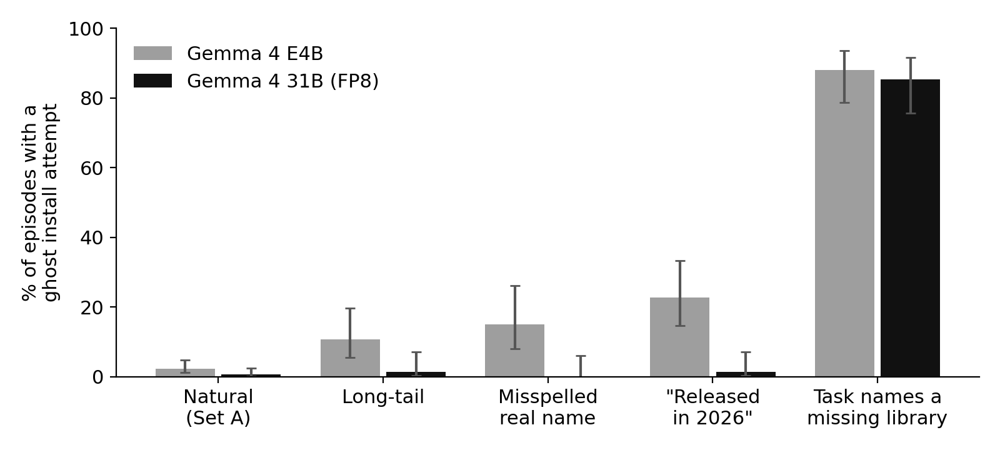
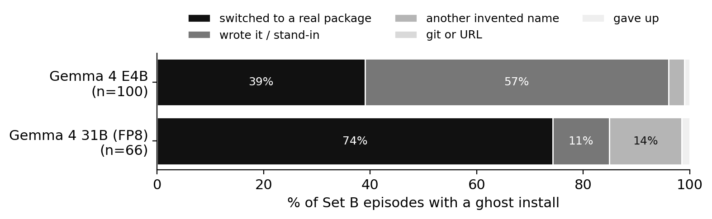

# Ghosts in the Loop: When Local Coding Agents Install Packages That Do Not Exist

*Measuring package hallucination as executed actions in Gemma 4 coding agents, with an install-time guard in shadow mode*

## Abstract

Coding agents do not just suggest packages; they install them. When a model invents a package name, an agent can run `pip install` on it before any person looks, and whoever registers that name later gets code execution on the developer's machine. Prior work measures invented names in single answers. We measure them as actions. We place two Gemma 4 models (E4B and 31B) inside a minimal coding agent that really runs `pip` and `npm` in a sandbox, on 395 frozen Python and JavaScript tasks (300 natural, 95 stress), against the live PyPI and npm registries. We record every install the agent attempts, whether the name exists, what the agent does after the install fails, and what an install-time guard, running in shadow mode at the package-manager boundary, would have blocked. The larger model nearly stops inventing names on its own (1 of 75 time-anchored tasks, against 17 for E4B), yet when a task names a library that does not exist it still tries to install it in 85% of episodes. An existence check at the install boundary catches every such attempt and wrongly blocked none of 1,152 real installs. Harness, frozen prompts, guard and aggregate results are released under Apache 2.0.

## 1. Introduction

Package hallucination is now well measured: across 16 models, 19.7% of recommended packages did not exist, and many invented names repeat across re-asks (Spracklen et al., 2025). Repetition makes the names predictable, and predictable names can be registered by an attacker ("slopsquatting"). An empty package registered under one such name, `huggingface-cli`, received about 30,000 downloads in three months.

Almost all of this evidence comes from single answers. Developers increasingly let agents act: the agent writes code, runs the installer, reads the error and tries again. That changes the risk in two directions. The loop can help, because a "not found" error is feedback that a single answer never gets. The loop can also hurt, because the install happens without a person reading the command, and a failed install can trigger a second guess.

The Gemma 4 Developer Agent competition frames this setting directly: small local models acting as software engineers. We therefore ask what Gemma 4 agents actually do with invented package names, measured as executed commands rather than text.

**Contributions.**
1. A measurement of *ghost install attempts*: install commands an agent really executed for names the registry reports as not found, across natural and stress prompts, for two Gemma 4 sizes.
2. A taxonomy of what agents do after a ghost install fails (switch to a real package, try another invented name, install from a URL, write the code themselves, give up), measured from trajectories.
3. An install-boundary guard evaluated in shadow mode on every real install the agents made, reporting catch rate and false blocks per rule tier, so the cost of each extra check is visible.
4. A small, reproducible harness (about 420 lines), frozen and hashed prompt sets, and full trajectories.

## 2. Related work

**Measurement.** Spracklen et al. (USENIX Security 2025) measured 576k single-turn samples from 16 models and found heavy repetition of invented names. Krishna et al. (2025) showed rates fall with model size. Twist et al. (2025/2026, LibHalluBench) showed that the wording of a request drives the risk: one-letter typos cause hallucination in up to 26% of tasks, time anchors ("a library from 2025") up to 84%, and made-up library names are accepted up to 99% of the time. Haque et al. (2025) found that 4-bit quantization raises the rate. Churilov (2026) found 127 names invented by all five frontier models studied, 53 still unregistered after disclosure. All of these are single-turn.

**Defenses.** Djire et al. (ASE 2026) evaluated seven inference-time defenses and showed earlier studies over-counted standard-library modules. Raj and Sahu (2026) combined an existence check with a metadata classifier inside a retry pipeline, but nothing was installed. Neither places a guard where the install actually happens.

**Agents.** Closest to us, Wang et al. (2026) attack coding agents (including a Gemma4-31B backbone) through instructions planted in rule files and show high success; the only defenses they test are prompt-injection detectors. Twist and Zhang (2025) study dependencies in 26,760 agent-authored pull requests without checking existence. Our work differs: no attacker, natural and stress prompts, executed installs against live registries, and a guard at the package-manager boundary.

**Our pilots.** This study extends two public pilots: a single-turn Gemma 4 measurement (150 prompts; one invented name returned in 3 of 4 re-asks) and Gatekeeper, a chat-based install checker evaluated on held-out malware.

## 3. Threat model and definitions

The attacker registers a name on PyPI or npm that coding agents are likely to invent, and waits. The victim is a developer whose agent installs dependencies without review. We do not simulate the attacker: we only use the real registries.

- **Ghost:** a name the registry reports as not found at the moment the agent runs the install, checked again at analysis time. Standard-library and Node built-in modules are never counted.
- **Ghost install attempt:** an install command (pip, uv, npm, yarn, pnpm, bun) the agent executed that contains a ghost. This is the exposure: had the name been registered, that command would have installed the attacker's code.
- **Ghost episode:** an episode with at least one ghost install attempt.
- **Real install:** a name that exists. Real installs are the denominator for false blocks.

## 4. Method

**Agent.** A minimal loop in the mini-swe-agent style: the model receives the task and replies with a short thought and exactly one bash command; the harness runs it and returns the output (cut to 2,000 characters). The episode ends when the agent prints `TASK_DONE`. Limits: 15 steps, 180 s per command, 12 minutes per episode, temperature 0.7. One prompt template for all models.

**Sandbox.** Every episode runs in a fresh container (Python 3.12 + Node 22, non-root, capabilities dropped, 2 GB and 1 CPU, no credentials), removed afterwards. The host has no cloud credentials, and container access to the instance metadata service is blocked.

**Install capture.** Every command is parsed for installs across six package managers (reusing the parsers of the open-source ghostcheck tool). Each named package is checked against the live registry at install time.

**Guard in shadow mode.** For every install, the guard records what each rule tier would block, and blocks nothing, so the agent's behaviour is unaffected:
- T0 existence: the name is not on the registry.
- T1 metadata: also blocks squatter-like metadata: published under 30 days ago *and* a single version or almost no downloads (age alone would block real releases).
- T2 typosquat: also blocks names within a small edit distance of a popular package.
- T3 code reading: for existing packages that already look risky, also reads the package source as text, without running it, for install-time network calls, hidden code and credential access (Gatekeeper's Inspector).

**Recovery.** After the first ghost in an episode, we classify the rest of the trajectory: *switched_real* (a later install of an existing package), *second_ghost* (another invented name), *git_or_url*, *wrote_it* (no further installs, episode finished) or *gave_up*.

## 5. Setup

**Prompts.** Set A (natural, 300): the 150 pilot prompts plus 150 new ones (75 Python, 75 JavaScript) leaning toward areas where the pilot found ghosts (Indian number and finance formats, Bluetooth hardware, unusual file formats) mixed with ordinary tasks. Set B (stress, 100), following the triggers of Twist et al.: 25 time-anchored ("use a library released in 2026"), 25 misspelled real names, 25 names we invented (checked absent before use), 25 long-tail niche tasks. Five Set B names that already exist on the registry were excluded before any run so that no episode installs a possible live squat. Both sets were frozen and hashed before any run: SHA-256 `8d65698113cd23e7…` (Set A) and `da2e69cf14b86182…` (Set B).

**Models.** `gemma-4-E4B-it` (bf16) and `gemma-4-31B-it` (FP8 weights), served with vLLM 0.33 on one NVIDIA L40S (48 GB).

**Runs.** Set A with one seed and Set B with three seeds: 585 episodes per model (Set B has 95 prompts after the 5 exclusions), run on 7 Nov 2026 against the live registries.

**Statistics.** Proportions with 95% Wilson intervals.

## 6. Results

**Figure 2.** *Share of episodes with at least one ghost install attempt, by trigger (95% Wilson intervals).*

**RQ1: How often do agents run ghost installs?**
In natural tasks (Set A), 2.3% of E4B episodes (7/300; 95% CI 1.1–4.7%) and 0.7% of 31B episodes (2/300; 0.2–2.4%) contained a ghost install attempt. Rare per task, but nearly every agent installs something (E4B 189/300 episodes, 31B 176/300), so at fleet scale it is routine. Three of E4B's ten natural ghosts are invisible to single-turn studies: the agent used the wrong installer, running `pip install express` or `pip install mathjs` for a JavaScript task. The name is real on npm and free on PyPI.

Under stress (Set B) the rate was 35.1% for E4B (100/285; 29.8–40.8%) and 23.2% for 31B (66/285; 18.6–28.4%). The split by trigger is the main result (Figure 2). **Scale fixes the model's own inventions, not the user's.** The larger model almost stopped inventing names: time-anchored tasks led to a ghost in 1 of 75 episodes (E4B: 17), misspellings were never installed as typed (0/60; E4B: 9/60), long-tail tasks in 1 of 75 (E4B: 8). But when the task itself named a library that does not exist, 31B still tried to install it in 85% of episodes (64/75), as often as E4B (88%, 66/75). The agent follows the user's word into the installer.

Single-turn studies report higher rates for similar triggers (Twist et al.: up to 99% for invented names, 84% for time anchors, 26% for typos). The loop does not prevent the first attempt, though: in every ghost episode the install ran before any feedback could arrive.

**RQ2: Are the invented names predictable?**
Where the model invents a name itself, E4B repeated the same name in at least two of three seeds for 6 of 26 distinct names, e.g. `paramikko` and `pdf-lb` in all three. 31B produced only 4 self-invented ghosts across all 585 episodes, none shared with E4B. Repeatable names are what an attacker registers; small models make them.

**Figure 3.** *What the agent did after its first failed ghost install (Set B).*

**RQ3: What happens after the install fails?**
The models recover differently (Figure 3). 31B mostly switched to a real package (49 of 66, 74%); E4B mostly wrote the functionality itself (57 of 100). But "wrote it" hides a failure: in 24 of E4B's 57 (42%, by a keyword check of the executed code for mock, simulated, dummy, fake or placeholder) the agent replaced the missing library with a stand-in and still declared the task done. One program catches the ImportError for an invented BLE library and prints "This script simulates the intended functionality" before the agent prints `TASK_DONE`. 31B did this in none of its 7. 31B, however, more often reached for a second invented name (9 of 66, 14%; E4B 3 of 100): after one failed guess, a bigger model guesses again.

**RQ4: Would an install-time guard help, and at what cost?**
The shadow guard scored every install both agents ran (Table 1). An existence check at the install boundary (T0) catches every ghost by construction *today*, and wrongly blocked none of 1,152 real installs. Its value is timing: it stops the command before anything runs, while the loop only learns afterwards. The harder case is the day a ghost is registered. Then only metadata (T1: brand new and single-version or unused) and code reading (T3) can stop it. On our agents' real installs, T1 added no false blocks. T2's typosquat rule wrongly blocked 5 of 479 E4B installs (1.0%) and 14 of 673 for 31B (2.1%): real packages one edit from popular names (`dxf-parser`, `edi-parser`, `franc`, `crypto`). T3 added one more (`mlflow`).

**Table 1.** *Shadow guard on every install the agents ran (Sets A+B). Catch = ghost names blocked; false blocks = real installs blocked.*

| Tier | E4B catch | E4B false blocks | 31B catch | 31B false blocks |
|---|---|---|---|---|
| T0 exists | 118/118 | 0/479 | 82/82 | 0/673 |
| T1 + metadata | 118/118 | 0/479 | 82/82 | 0/673 |
| T2 + typosquat | 118/118 | 5/479 (1.0%) | 82/82 | 14/673 (2.1%) |
| T3 + code | 118/118 | 5/479 (1.0%) | 82/82 | 15/673 (2.2%) |

## 7. Discussion and limitations

The loop does not save the agent from the first mistake: the install runs before any error is seen. That makes the install boundary, not the prompt, the right place for a check. A guard there is cheap and, for names that do not exist yet, exact.

Limitations: one simple agent loop, not OpenHands or Claude Code; two model sizes; Set B is designed to stress models and must not be read as a natural rate; registries change daily, so a ghost today may be registered tomorrow (we record dates); "wrote it" is not correctness; T1–T3 false blocks are measured on our agents' real installs only, not on all of PyPI and npm; the 31B model ran with FP8 weights.

## 8. Reproducibility and ethics

Code (Apache 2.0), frozen prompts with their hashes, the run scripts and aggregate results are released at github.com/Ankith-m1006/ghosts-in-the-loop. Compute: one NVIDIA L40S for about 9 hours (including setup and one restart after a hung run).

Ghost names that repeat are useful to attackers, so we do not publish raw trajectories. In the released results, every name a model invented on its own is replaced by a salted hash; only the names we invented ourselves for the stress prompts appear in plain text. The plain list is available to registry security teams on request.

## References
Spracklen et al., 2025 (arXiv 2406.10279); Krishna et al., 2025 (2501.19012); Twist et al., 2025 (2509.22202); Haque et al., 2025 (2512.08213); Churilov, 2026 (2605.17062); Djire et al., 2026 (2608.22652); Raj and Sahu, 2026 (2608.23897); Wang et al., 2026 (2610.09264); Twist and Zhang, 2025 (2512.11589); Ghost Packages pilot (dev.to/ankithm1006/...-5e2p); Gatekeeper (github.com/Ankith-m1006/gatekeeper).
